<p align="center"></p>

| | |
|-|-|
| **Time** | 45-60 min |
| **Cost** | free |
| **You need** | Bash and `shellcheck` in your Ubuntu environment (`sudo apt install shellcheck`) |

## How this lab works

1. **Fork** this repository to your own GitHub account (button at the top right).
2. Clone **your fork** in your Ubuntu environment (WSL on Windows, your OrbStack machine on Mac).
3. Read the lab below (the same text is in [`LAB.md`](LAB.md)) and follow the mission.
4. Answer the questions in [`SUBMISSION.md`](SUBMISSION.md). Where a question asks for output, paste it in a code block. No screenshots needed.
5. Commit and push. Open the **Actions** tab of your fork (click *I understand my workflows, go ahead and enable them* the first time). The **Lab check** shows what is still missing.
6. When the check is green, **submit the URL of your fork** in the course platform.

> [!NOTE]
> The check only looks at your answers and any files the lab asks you to commit. Your instructor reads your work and may ask you to explain any line.

<p align="center"></p>

## The situation

The sysadmin who wrote Clipstr's operations scripts left last month. Four of them still run every night from cron: a backup, a cache cleanup, a log rotation and a health check. They "work". Nobody dares to touch them. Then last Wednesday the cleanup script ran with an empty variable and wiped a folder it should never have touched.

The CTO has asked you to make the scripts safe before the next incident, without changing what they are for.

> [!IMPORTANT]
> **Your mission**
> - Run `shellcheck` and **understand** every finding, do not just silence it
> - Break the scripts yourself with hostile input before fixing them
> - Make each script safe and predictable, and prove it with tests

**Time:** 45-60 min | **Cost:** free | **You need:** Bash and `shellcheck` (`sudo apt install shellcheck`)

<p align="center"></p>

## Part 0 - Set the scene

Fork this repository, clone your fork, and run:

```bash
./setup.sh
```

The four legacy scripts are in `scripts/`. Open each one and read it before you run anything. What does each do? Who calls it, with which arguments?

<p align="center"></p>

## Part 1 - Recon: let the linter talk

```bash
shellcheck scripts/*.sh
```

shellcheck prints a code (like `SC2086`), a line and an explanation. Open the wiki page for each code (`https://www.shellcheck.net/wiki/SC2086`): it has "problematic code" and "correct code" examples.

1. How many findings does each script have? Make a small table: script, number of findings, codes.
2. Which codes repeat? What do they have in common?
3. Which findings are *only style* and which could cause **data loss or a wrong result**?

> [!NOTE]
> **Predict** Which of the four scripts do you think is the most dangerous? Write it down before you test them.

<p align="center"></p>

## Part 2 - Break them on purpose

Do these in a **scratch directory**, never against real data. First, from the root of this repo, remember where the scripts are: `export S="$PWD/scripts"`. For each hostile input, predict what the script will do, then run it.

**backup.sh**

```bash
mkdir -p /tmp/lab/src && cd /tmp/lab
echo hello > "src/my file.txt"; echo hi > src/plain.txt
"$S"/backup.sh src "dest dir"
```

What happens to `my file.txt`? How many files does the final message report?

**cleanup.sh**

```bash
mkdir -p /tmp/lab/data/cache /tmp/lab/data/precious; touch /tmp/lab/data/precious/keepme
DATA_DIR=/tmp/lab/data "$S"/cleanup.sh ""
ls /tmp/lab/data/precious
```

What happened to `keepme`? Now think about what the same script does when `DATA_DIR` is unset **and** the argument is `cache`. Do **not** run that one: write down, from the code, which path `rm -rf` would receive.

**rotate.sh**

```bash
cd /tmp/lab && mkdir "my logs" && cd "my logs"
for i in 1 2 3 4 5; do touch app$i.log; done
"$S"/rotate.sh "/tmp/lab/my logs"
"$S"/rotate.sh /tmp/lab/does-not-exist
```

What does the second call do to the current directory?

**health.sh**

```bash
"$S"/health.sh http://127.0.0.1:9 1; echo "exit: $?"
"$S"/health.sh; echo "exit: $?"
```

> [!WARNING]
> **Break it** For the worst bug, write a one-sentence incident report: what input, what the script did, what it should have done.

<p align="center"></p>

## Part 3 - Fix them

Fix each script in `scripts/` in place. Use these tools, and be able to say what each one does:

- `#!/usr/bin/env bash` and `set -euo pipefail`
- Quote every expansion: `"$var"`, `"${array[@]}"`
- Argument checks with a usage message and **exit code 2**
- Guards against empty variables: `${VAR:?message}` or an explicit test
- `cd -- "$dir" || exit` (never `cd` without checking)
- Loops over **globs** (`for f in "$dir"/*`), never `for f in $(ls ...)`
- `$( )` instead of backticks, `--` before filenames that might start with `-`

Rules of the game:

1. Keep each script's purpose and arguments. The tests call them exactly as before.
2. `shellcheck scripts/*.sh` must print **nothing**: do not add `# shellcheck disable` comments to hide a finding.
3. The scripts must behave on awkward input: spaces in names, empty arguments, missing folders.

> [!NOTE]
> **Think** When is a `# shellcheck disable=SCxxxx` comment actually acceptable? What must come with it?

<p align="center"></p>

## Part 4 - Prove it

```bash
./verify.sh
```

It runs shellcheck on every script and then exercises each one with the hostile inputs from Part 2 inside a private temporary directory.

<p align="center"></p>

## Level up (optional)

- **bats.** Install `bats` and write three real tests for `rotate.sh`. Which setup/teardown do they need?
- **Pre-commit.** Add a Git pre-commit hook that runs shellcheck on staged `.sh` files and blocks the commit when it fails.
- **A bug shellcheck cannot see.** Write a script that is shellcheck-clean but wrong (an off-by-one in `rotate.sh` is a good candidate). How would you catch it?

<!-- submission:start (generated by labs.py, do not edit) -->
## Submission

Answer the questions in `SUBMISSION.md` in **your fork** (paste output in code blocks where asked), push, then submit the **URL of your fork**.

**Files to commit**

- The four fixed scripts in `scripts/`, committed to the repo (no `shellcheck disable` comments)

**Questions to answer**

1. For each script, list the warning codes shellcheck reported (for example SC2086) and explain one in your own words: what could go wrong and with what input?
2. Describe the worst bug you found and the input that triggers it. What was the damage, and what is the one-line guard that prevents it?
3. Why does `for f in $(ls dir)` fail on a filename with a space, and what do you use instead?
4. Is a script with zero shellcheck warnings guaranteed to be correct? Give an example of a bug shellcheck cannot find.
5. Paste the output of `./verify.sh`. It must end with **ALL CHECKS PASSED**.
<!-- submission:end -->
